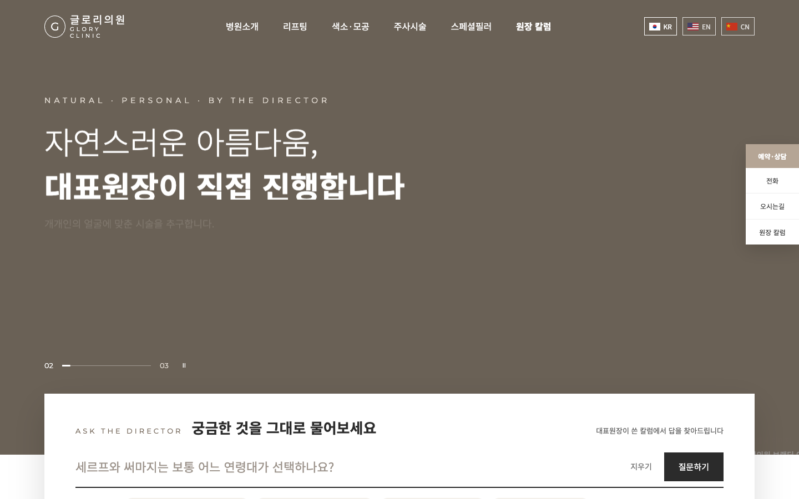
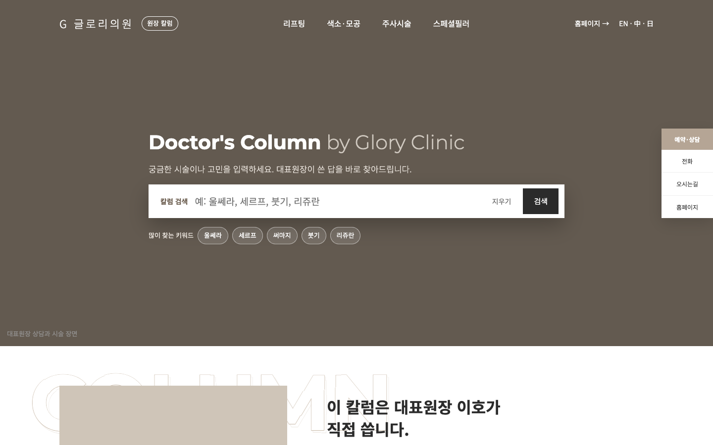
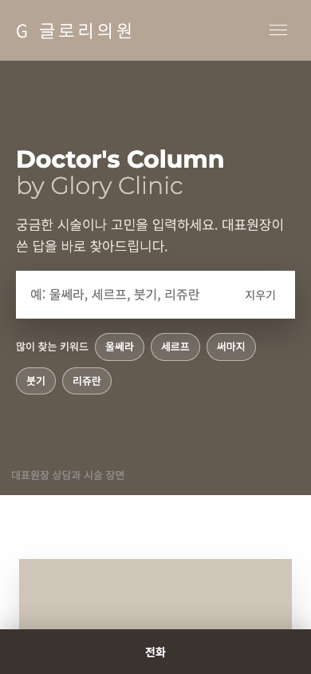

# 수정 요청 #5-1 검증 보고서

검증일: 2026-11-11 (Asia/Seoul)

## 수정 결과

| 항목 | 결과 | 내용 |
| --- | --- | --- |
| 홈 히어로 배경 CSS 충돌 | PASS | `components/HomeHero.module.css`의 `.heroMedia`에 `position: absolute !important` 적용 |
| 칼럼 메인 히어로 배경 CSS 충돌 | PASS | `app/column/page.module.css`의 `.heroImage`에 `position: absolute !important` 적용 |
| 같은 패턴 전수 확인 | PASS | `ImageSlot`에 절대 배치를 주는 시설 갤러리의 `.blurBackground`, `.photoSlot`은 이미 `!important` 적용 상태임을 확인. 남아 있던 홈 레거시 `.heroMedia`도 동일하게 보강 |
| OutlineWord 선 색 | PASS | 기본 선 색을 `#e6dfd6`에서 `#cfc2b3`로 변경. 두 번째 선의 `opacity: .42` 유지 |
| OutlineWord 그리기 모션 | PASS | 운영 번들에서 `DIRECTOR` 진입 시 `outlineDraw`, 2.6초, `stroke-dashoffset` 진행과 `rgb(207, 194, 179)` 확인 |
| 스크롤 고정 헤더 | PASS | 지원 브라우저에서 `rgba(43, 43, 43, .72)` + `backdrop-filter: blur(12px)`, 미지원 시 `#3a332d` 적용 |
| 기준 자료/출력 폴더 | PASS | `docs/design/motion-study.html` 포함, `output/`을 `.gitignore`에 추가 |

## 빌드 및 폭별 첫 화면 확인

- `npm run build`: PASS (Next.js 16.4.3, TypeScript 및 정적 페이지 생성 완료)
- `npm run start -p 3101`: 실행 환경의 로컬 포트 권한 제한으로 `listen EPERM` 발생
- 운영 검증 대체 절차: `next build`가 생성한 `.next/server/app/*.html`과 운영 CSS/JS 청크를 로컬 정적 서버에서 그대로 제공하여 Playwright로 검사

| 페이지 | 폭 | 제목 표시 | 히어로 배경 계산값 | 가로 넘침 |
| --- | ---: | --- | --- | --- |
| 홈 | 1440 | PASS | `position: absolute` | 없음 |
| 홈 | 1024 | PASS (`top 214.39`, `bottom 359.98`) | `position: absolute` | `1024 / 1024` |
| 홈 | 390 | PASS | `position: absolute` | 없음 |
| 칼럼 메인 | 1440 | PASS | `position: absolute` | 없음 |
| 칼럼 메인 | 1024 | PASS (`top 239`, `bottom 283`) | `position: absolute` | `1024 / 1024` |
| 칼럼 메인 | 390 | PASS | `position: absolute` | 없음 |

1024px 홈에서 스크롤 후 계산 스타일은 `background-color: rgba(43, 43, 43, 0.72)`, `backdrop-filter: blur(12px)`로 확인했다.

## 운영 번들 스크린샷

### 홈 1440px

### 홈 390px

### 칼럼 메인 1440px

### 칼럼 메인 390px

## 변경 파일

- `.gitignore`
- `components/HomeHero.module.css`
- `app/column/page.module.css`
- `app/page.module.css`
- `components/motion/OutlineWord.tsx`
- `components/ColumnHeader.module.css`
- `docs/design/motion-study.html`
- `docs/compare/motion/*-production-*.png`
- `docs/compare/report-5-1.md`
